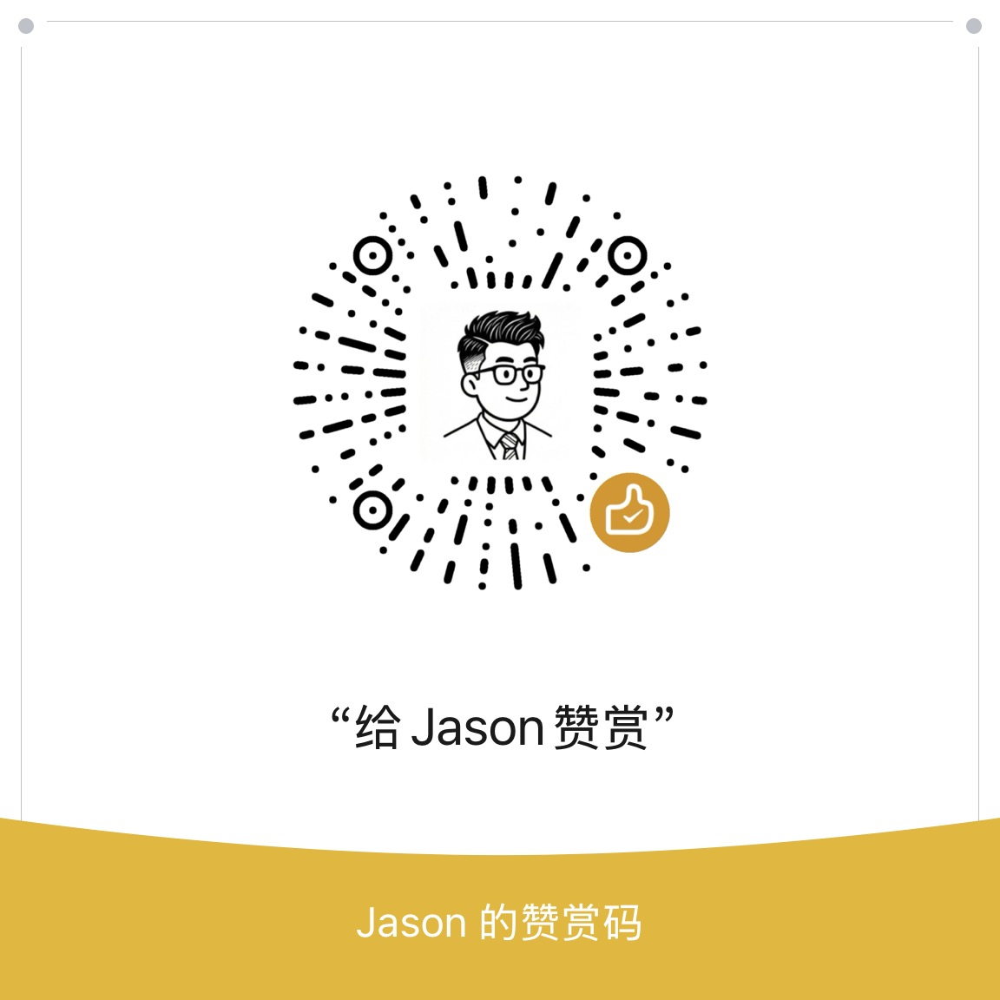

# Multi Protocol Node

**个人自用六协议 VPS 部署 Skill：搭建、证书续期、配置导出和连接验证。**

[](LICENSE)

面向自有或明确获授权的 Debian / Ubuntu 服务器，提供 **Codex Skill + 独立 Python 工具**。兼容搬瓦工、DMIT 等普通 VPS，不绑定服务商。默认六协议，不要求购买域名；保留旧三协议模式及其配置导出、验证能力。

| 协议 | 默认端口 | 定位 |
|---|---|---|
| VLESS + REALITY + Vision | TCP 443 | 推荐主用，REALITY 握手验证 |
| Trojan | TCP 8443 | TCP / TLS 备用，可信证书验证 |
| Hysteria 2 | UDP 24443 | UDP 可用时测试速度和稳定性 |
| TUIC | UDP 8443 | QUIC 备选，关闭 0-RTT |
| AnyTLS | TCP 9443 | 支持新版客户端时的 TCP / TLS 备选 |
| Shadowsocks AEAD | TCP / UDP 8388 | 兼容备用，不具备前向保密 |

## 什么环境用什么协议？

**先保证身份验证正确，再考虑可用性和速度。没有一种协议在所有环境下都“最安全”。**

| 环境 | 项目建议 |
|---|---|
| 家庭宽带、日常办公 | REALITY 主用，Trojan 备用 |
| 陌生 Wi-Fi | 使用已验证服务端身份的 REALITY / Trojan；保持 HTTPS，不跳过证书校验 |
| UDP 不通或被限制 | REALITY / Trojan / AnyTLS 等 TCP 方案 |
| 蜂窝网络、丢包但 UDP 可用 | 实测 Hysteria 2 / TUIC，并保留 TCP 备用 |
| 大文件、视频 | 比较持续吞吐和稳定性；低延迟不代表更安全或下载更快 |
| 新版客户端、希望尝试其他实现 | AnyTLS，先检查支持与实际连接 |
| 旧客户端只能用 SS | SS 兼容备用，优先升级客户端 |

完整说明：[协议选择与安全边界](skills/multi-protocol-node/references/protocol-choice.md)。其中包括证书、0-RTT、前向保密、DNS/TUN 覆盖与账号隐私的区别，并附官方来源。多协议共用一台服务器，不是独立线路容灾，也不保证不可识别或不会被封。

## 功能

- 检查系统、端口和已有防火墙；拒绝覆盖旧部署，不修改 SSH 或个人 Surge。
- 固定 Xray、sing-box、Hysteria 与 acme.sh 版本/提交，SHA-256 验证后执行。
- 六协议默认使用公共 IP 证书，定时续期；也可使用已有可信证书。
- 独立随机凭证、开机自启、失败重启；普通安装异常清理本次创建的目录与服务。
- 私密导出链接、可选二维码、sing-box 配置、Mihomo 配置和个人使用说明。
- 逐协议外部 HTTPS 验证，失败返回非零退出码，不把“启动了”当成“能用了”。

## 安装为 Skill

```sh
git clone https://github.com/jasonbitsmith/multi-protocol-node.git
mkdir -p ~/.codex/skills
cp -R multi-protocol-node/skills/multi-protocol-node ~/.codex/skills/
```

已有同名 Skill 时先比较版本，不要盲目覆盖。重新打开或刷新支持 Skill 的会话后输入：

> 使用 $multi-protocol-node，在我的 VPS 上部署六协议个人节点。SSH 别名是 my-vps，我自己使用 Windows 和 iPhone。检查现有服务，配置可靠的证书续期，最后验证连接并生成配置包。

Skill 沿用已有授权和 SSH 登录方式，不包含服务器密码。支持读取 `SKILL.md` 的其他代理也能使用脚本。

## 直接运行

本地需要 Linux/macOS、Python 3.10+、OpenSSH、curl；Windows 可用 WSL。服务器需要 Debian/Ubuntu、systemd、Python 3.10+，支持 amd64/arm64，当前要求公网 IPv4。确认目标机器后可安装依赖：

```sh
apt-get update
apt-get install -y python3 curl openssl iproute2 ca-certificates socat
```

先正常 SSH 登录并核对主机指纹。示例使用 root SSH 别名 `my-vps`；非 22 端口需要每次显式添加 `--ssh-port 实际端口`。用真实值替换大写占位符。

```sh
cd multi-protocol-node
python3 -m venv .venv
. .venv/bin/activate
# 可选：生成二维码
pip install -r skills/multi-protocol-node/requirements-export.txt

# 默认 --profile six --tls-mode public-ip
python skills/multi-protocol-node/scripts/node.py install \
  --ssh my-vps --host YOUR_PUBLIC_IPV4 --target YOUR_REALITY_TARGET

# 必须使用新的私密输出目录，建议放在代码仓库外
python skills/multi-protocol-node/scripts/node.py fetch \
  --ssh my-vps --output "$HOME/private-node-exports/my-vps"

# 在 VPS 外执行，不要用服务端自测冒充外部可达
python skills/multi-protocol-node/scripts/node.py verify \
  --directory "$HOME/private-node-exports/my-vps"
```

REALITY 目标须从服务器可达、支持 TLS 1.3 / h2，仍需外部握手测试。本项目不提供“永远安全”的默认目标。

### 证书与端口

默认模式自动向 Let's Encrypt 注册 ACME 账号、签发 IP 短期证书，申请会将公网 IP 提交给 CA 并写入公开证书透明度记录。签发使用 HTTP-01：**TCP80 必须空闲且公网可达**，后续续期也需要。ACME 账号和证书都保存在本项目的私密目录，不改全局 cron。

IP 证书有效期约六天。本项目每六小时检查续期；签发/续期成功后重启相应服务，可能短暂重连。不要封禁验证端口，也不要忽略定时器失败。[CA 官方说明](https://letsencrypt.org/2026/01/15/6day-and-ip-general-availability)

若已有可信证书，文件路径指向**目标服务器上的文件**：

```sh
python skills/multi-protocol-node/scripts/node.py install \
  --ssh my-vps --host YOUR_PUBLIC_IPV4 --target YOUR_REALITY_TARGET \
  --tls-mode provided --tls-name YOUR_CERTIFICATE_NAME \
  --cert-file /etc/your-certs/fullchain.pem --key-file /etc/your-certs/key.pem
```

provided 模式验证公共信任链、IP/域名、私钥匹配及剩余有效期后复制证书。**它不自动接管续期**：原证书管理器须将新文件部署到本项目目录并重启对应服务。详见 [运维说明](skills/multi-protocol-node/references/operations.md)。

所有端口可参数化：`--reality-port`、`--trojan-port`、`--hysteria-port`、`--tuic-port`、`--anytls-port`、`--ss-port`。TCP/UDP 可以共用数字，但同一传输不能重复；公共 IP 证书模式另保留 TCP80。

脚本不修改主机防火墙和供应商安全组。发现已有规则会停止，确认允许所需端口后可使用 `--firewall-reviewed`；该参数不会替你放行任何端口。

### 三协议与旧安装

新部署加 `--profile three` 可使用原三协议方案（REALITY、Hy2、SS）。Hy2 使用自签名证书及精确指纹，不申请公共 IP 证书。新部署的 Hy2 默认端口统一为 UDP24443；已有配置端口保持原值。

`fetch` / `verify` 会识别旧三协议元数据。**没有原地升级、自动收缩或强制重装功能**：已有服务一律拒绝覆盖。手动扩展过的非标准部署也不会自动接管，应先备份和制定迁移方案。

## 个人设备配置

将 `client-bundle.zip` 私密传到自己的设备。六协议包包含：

- 六种协议的独立链接及可选二维码。
- `default-import.txt`：REALITY + Trojan；`all-protocols.txt`：全部六种。
- `sing-box.json`：本机 HTTP/SOCKS 10808，默认 REALITY。
- `Clash-Mihomo.yaml`：可手动选择或对前五种协议自动测速；**SS 不参加 Auto**。
- 个人使用说明。包内不含 SSH 密码、服务端私钥或 ACME 账号。

iPhone 可用支持相应协议的 Shadowrocket 扫码；Windows 可用最新版 v2rayN 导入链接并选择相应核心，或用兼容 Mihomo 的客户端导入配置。AnyTLS/TUIC 等必须确认客户端支持；没有测试过的 App 版本不能仅凭成功导出就判定兼容。

六协议配置保持证书验证开启，不用自签名证书固定指纹，公共证书续期不要求重新分发 pin。旧三协议 Hy2 的指纹逻辑不同，不能混用。

导出的是基本代理配置，默认不提供国内分流、不接管系统 DNS，也不是完整手机 TUN 配置。需要全设备代理时自行配置 TUN/VPN 与 DNS，再检查实际覆盖范围。所有链接和二维码均为访问凭证，请勿上传公开仓库。

## 状态、卸载与测试

```sh
python skills/multi-protocol-node/scripts/node.py status --ssh my-vps
# 会断开此安装上的全部连接；同时移除其续期资源
python skills/multi-protocol-node/scripts/node.py uninstall --ssh my-vps

python -m unittest discover -s tests -v
# 可选：使用已校验的官方二进制做本机协议冒烟测试
python tests/smoke_binaries.py --xray /path/to/xray --hysteria /path/to/hysteria \
  --sing-box /path/to/sing-box --mihomo /path/to/mihomo
```

六协议对应 `mpn-xray`（SS）、`mpn-hysteria`（Hy2）、`mpn-extra`（REALITY/Trojan/TUIC/AnyTLS），公共 IP 模式还包括证书服务与定时器。数据位于 `/opt/multi-protocol-node`。卸载验证所有权并仅删除受管资源，不改 SSH、防火墙和外部证书源文件。

验证覆盖包括：旧三协议兼容、六协议端口冲突、TLS 与 0-RTT 默认值、导出凭证隔离、证书/服务失败回滚、续期资源卸载。真实二进制验证过生成的配置与正确/错误指纹握手；六协议方案已在 Ubuntu amd64 及 sing-box/Mihomo 客户端上实测。**这不等于所有发行版、架构和手机 App 均完成端到端认证。**

可将 `examples/github-actions-tests.yml` 复制为 `.github/workflows/tests.yml` 启用离线 CI；推送需要工作流写入权限，当前仅提供模板，不会部署真实服务器。

## 贡献与许可

欢迎提交脱敏问题报告或 PR，说明系统、架构、客户端版本与失败阶段，不要附服务器登录信息、私钥或二维码。本项目脚本和文档采用 [MIT License](LICENSE)，下载的上游软件保留各自许可证。仅管理自有或明确获授权的服务器。

## 📬 联系方式

- 𝕏：[@evanwritesx](https://x.com/evanwritesx)
- Telegram：[@EvanCreates](https://t.me/EvanCreates)
- TG 交流群：[t.me/jason_Telegramx](https://t.me/jason_Telegramx)
- TG 频道：[t.me/APPKITLIFE](https://t.me/APPKITLIFE)

<a id="support"></a>

## ☕ 支持项目

如果这个项目帮你省下了搭建和维护个人节点的时间，欢迎自愿赞赏，支持项目维护与持续更新。感谢每一份支持，也欢迎通过 Star、Issue 或 PR 参与项目。

<table>
  <tr>
    <th align="center">支付宝</th>
    <th align="center">微信赞赏</th>
  </tr>
  <tr>
    <td align="center"><a href="assets/sponsor/alipay.jpg"></a></td>
    <td align="center"><a href="assets/sponsor/wechat.jpg"></a></td>
  </tr>
</table>

使用对应 App 扫码，或点击图片查看原图后保存识别。赞赏完全自愿，项目仍可免费使用。
